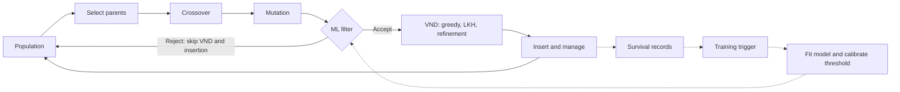

# Assessing the Viability of Pre-Local-Search Surrogate Filtering: A Diagnostic Study of Survival-Based Offspring Pruning in a Memetic Algorithm for the Close-Enough Traveling Salesman Problem

[](https://en.cppreference.com/w/cpp/17)
[](https://www.python.org/)
[](LICENSE)
[](https://www.gurobi.com/)
[](http://akira.ruc.dk/~keld/research/LKH/)

This repository provides the official implementation, experimental benchmarks, and diagnostic reproducibility suite for the research paper:

> **Assessing the Viability of Pre-Local-Search Surrogate Filtering: A Diagnostic Study of Survival-Based Offspring Pruning in a Memetic Algorithm for the Close-Enough Traveling Salesman Problem**<br>
> *Demir Balemir and Deniz Cantürk*<br>
> TED University, Ankara, Türkiye<br>
> Target journal: *IEEE Access*

The study investigates whether an offspring's pre-local-search features support useful rejection before expensive local search in a memetic algorithm for the **Close-Enough Traveling Salesman Problem (CETSP)**. The historical nine-model evaluation used 53 instances and five seeds (2,650 island outcomes). Separate Cox/random/unfiltered and corrected-neural re-evaluations each contain 795 runs. The corrected filters showed no detectable final-cost advantage and required more total runtime in the evaluated execution regimes.

To investigate this outcome, the paper presents diagnostic analyses of target predictability, rank transmission through local search, and discrimination beyond temporal drift. These motivate a **one-sided viability gate**, assessed retrospectively in the tested system.

---

## Current IEEE Access revision

The [November 2026 experiment/reproduction reference](reproducibility/revision_20261109/README.md) contains the final saved results, frozen deployed code, selected diagnostic inputs, folds, predictions and compact training audits. This is the public result-level reference for the latest experiments. Submission documents remain separate; `paper/` and `Article.pdf` are historical manuscript versions.

The changes are distinct:

1. Correct the existing neural training path by removing invalid validation-loss early stopping; audit fixed-epoch learning.
2. Change MTLR's operational score separately to a finite-horizon negative step-RMST.
3. Compare all nine families on the same 18,115 selected records and run-held-out folds (30 reused neural fits plus 105 other fits).
4. Re-evaluate existing DeepSurv/MTLR implementations against a fresh unfiltered control in 795 runs. DeepSurv and MTLR take 5.28% and 4.02% longer (six-test Holm p=0.004252 and 0.045651), without a detectable cost advantage.
5. Keep the separate 795-run Cox/random/unfiltered study: Cox takes 7.95% longer than random and 6.11% longer than unfiltered; no cost contrast survives Holm adjustment.

The historical neural rows retain their arithmetic and implementation qualifications. The common-sample model concordance range is 0.526–0.569. It does not re-estimate the older oracle/clock on that sample, and it is separate from the fixed-Cox within-time diagnostic. Each neural arm contains 175 trained runs and 90 runs that stopped before training; all 350 saved final networks have fitting audits.

**Saved-result verification, no solver or fitting:**

```console
python reproducibility/revision_20261109/reproduce_revision_results.py
```

Install the [recorded analysis dependencies](reproducibility/revision_20261109/requirements-saved-results.txt) first. The script checks six neural contrasts, 135 saved-prediction fold C-indices, operational totals and six separate Cox contrasts. See the reference README for data and hash scope. Full raw neural run archives and weights are retained by the authors, not embedded in Git.

The numerical refinement policy remains part of the evaluated pipeline. Cox follow-up counts include 628,249 numerical-no-solution fallbacks in 1,245,598 conic calls. The corrected-neural study has its own counts: 620,134 fallbacks and 610,674 successful calls. A [separate saved SOCP representation diagnostic](reproducibility/socp_diagnostic_20261107/README_PUBLIC.md) shows one subproblem resolved by implied coordinate bounds; no end-to-end rerun with those bounds was performed.

All 2,650 original best costs, runtimes and rejection counts matched post-join summaries. Auxiliary iteration-field uncertainty and historical executable-identity limits remain documented in the reporting reference.

## Key Empirical & Diagnostic Findings

The end-to-end experiment and the offline diagnostics use different samples:

| Analysis | Sample | Main observation |
|---|---|---|
| Historical end-to-end filtering | 53 test instances × 5 runs × 10 islands = 2,650 island runs | No detectable quality/runtime advantage; historical neural/Cox implementation scope applies |
| Corrected Cox control | 53 instances × 5 common seeds × 3 methods = 795 runs, plus 159 separate calibration runs | No detectable adjusted cost advantage; greater Cox total runtime |
| Corrected neural re-evaluation | 53 instances × 5 common seeds × DeepSurv/MTLR/fresh unfiltered = 795 runs | No detectable cost advantage; runtime +5.28% / +4.02% |
| Updated common-sample diagnostic | 5 instances; 18,115 positive-lifetime eviction records; 135 held-out fold scores | Equal-instance mean concordance 0.526–0.569 across nine families |
| Older oracle/feature diagnostics | Smaller, separately selected recorded samples | Post-VND empirical oracle reference 0.687; not a common-sample bound |
| Full-VND rank–gain calibration | 25 instances | Mean recorded-cohort coefficient 0.889; direct cost-rank concordance 0.560 |
| Stage-wise local-search measurements | 3 instrumented instances | Instance-dependent transmission through greedy, LKH and refinement stages |

In the historical experiment, quality comparisons cover all 53 test instances; runtime tests use the 47 with at least one recorded rejection. Tests pair instance-level means, while island seeds differ by island ID. Runtime is to the stopping rule under concurrent-island contention, rather than to a common solution-quality target. The absence of statistical significance does not establish equivalence.

Among the 2,385 ML island runs, 1,533 reached the nominal 1,000-iteration training floor; three ended exactly at that boundary. The median post-floor window was 1,083 iterations, approximately 52% of run length. Reaching the floor is distinct from having a non-empty active filtering window.

The diagnostics are conditional on recorded, admitted, positive-lifetime solutions. Unadmitted offspring and terminal control survivors are absent, and reconstructed cohorts are incomplete. The five-instance sample includes one development instance; the 25-instance sample includes eight. Their memberships are recorded in the [instance manifest](analysis_la_cetsp/results/instance_manifest.csv).

The oracle is a fitted empirical reference, not a formal prediction ceiling or proof that survival is inherently unpredictable. Rank–gain association alone does not establish rank destruction or filtering infeasibility. Clock comparisons contextualise the measured discrimination. The revision adds a fixed-Cox within-time and time-plus-feature analysis on 16 matched test instances (29,908 records); this is a selected-sample diagnostic, not a re-evaluation of all nine deployed models. See [paper/README.md](paper/README.md) for the protocols and limitations.

---

## The Three-Check Viability Gate

| Check | Measurement | Evidence in this study |
|---|---|---|
| Target predictability | Fit an empirical oracle using recorded post-step information | Oracle concordance 0.687 |
| Rank transmission | Assess input-output ordering alongside Spearman(input cohort rank, relative gain) | Full-VND coefficient 0.889; cost-rank concordance 0.560 |
| Discrimination beyond drift | Compare candidate features with a matched iteration-index control | Best tested feature representation 0.605; clock 0.613 |

**One-sided interpretation:** adverse findings can support reconsidering the tested design; favourable findings justify further evaluation without establishing net benefit. The gate has been applied retrospectively in one pipeline. Prospective validation remains future work; no universal cut-point is claimed. The revision includes a corrected Cox versus independently calibrated random-pruning comparison; the other eight models have no random-pruning ablation.

---

## System Architecture

The solver embeds surrogate filtering into the state-of-the-art MA-CETSP algorithm (Lei & Hao, 2024):



Population fitness combines cost rank and diversity rank as
$r_{val}+\beta r_{div}$ with $\beta=0.96$. Rejected offspring bypass VND and insertion;
their rejection does not advance the stagnation counter.

### Components
- **Pre-Local-Search Features (10):** Pre-VND tour cost, edge length mean and variance, bounding box width, height, and area, centroid coordinates $(x, y)$, sum of point-to-centroid distances, and interior turning angle variance.
- **Nine Survival Model Families:**
  - *Cox Proportional Hazards (Cox PH)*: Semi-parametric linear baseline, implemented natively in C++.
  - *ElasticNet Cox*: Regularised linear Cox model for collinear feature sets.
  - *Random Survival Forests (RSF)*: Ensembled survival trees via bagging.
  - *Gradient Boosting Survival Analysis (GBSA)*: Stagewise Cox partial-likelihood boosting.
  - *DeepSurv*: Multilayer neural network (2 hidden layers, 64 units, batch norm, dropout).
  - *Multi-Task Logistic Regression (MTLR)*: Neural network discretising the time axis into logistic models.
  - *Survival Support Vector Machines (SSVM)*: Linear FastSurvivalSVM ranking formulation for censored pairs; no kernel model was evaluated.
  - *Weibull Accelerated Failure Time (Weibull AFT)*: Parametric log-survival regression.
  - *$k$-NN Survival*: Non-parametric risk estimator using the 15 nearest neighbours.
- **Resident Process IPC:** Non-Cox models are served by a resident Python process communicating over standard anonymous I/O pipes via single-line JSON requests, removing interpreter start-up overhead.
- **Adaptive Training Trigger:** Fires when both $\text{iter} \ge 0.20 \cdot T$ and $\#\{\text{observed evictions}\} \ge 100$, with a hard fallback at $0.50 \cdot T$. The trigger does not alter or reset the stagnation counter.
- **Threshold Calibration:** Selected on a held-out 20% validation split by maximising regularised survival gap:
  $$J(r, g) = g \cdot \min\left(1, \frac{r}{r^*}\right) - \lambda \max(0, r - r^*)$$
  with target rejection rate $r^* = 0.20$ and penalty $\lambda = 2$.
- **Rolling Rejection-Rate Cap:** Suspends filtering for the next window if the rejection rate exceeds 30% over a window of 50 ML-eligible offspring.
- **Parallel Multi-Island Portfolio:** 10 concurrent threads (9 ML models + 1 in-run unfiltered control), seeded with $\sigma + i$. No migration occurs between islands. The control shares the machine and stopping rules; timing is subject to contention and island seeds are offset.
- **Stagnation Neutrality:** Rejected offspring bypass VND entirely and neither increment nor reset the non-improving stagnation counter $\pi$.

---

## Experimental Setup & Full Results

### Execution Environment
- **CPU:** Intel Core i7-12700H (14 cores / 20 threads, 2.7 GHz, 32 GB DDR4 RAM)
- **OS:** Windows 11 Pro (26200)
- **Compiler:** MSVC 2022 (C++17, `/O2`), CMake 4.2
- **Solvers:** Gurobi 12.0.3, LKH 2.0.11
- **Python:** 3.10.9 (scikit-survival 0.25.0, lifelines 0.30.0, scikit-learn 1.7.2, PyTorch 2.11 CPU, pycox 0.3.0)

### Historical Benchmark Results (53 Instances $\times$ 5 Seeds = 2,650 Island-Runs)

| Model | Class | Mean Best Cost | Degradation (%) | Control/model runtime | Reject (%) | Wilcoxon Quality ($p$) | Wilcoxon total runtime ($p$) |
|---|---|---|---|---|---|---|---|
| **Baseline (no ML)** | Control | 905.956 | +0.000% | 1.000 | 0.00% | — | — |
| **RSF** | Tree ensemble | 906.253 | -0.009% | 1.008 | 2.01% | 0.944 ($n=39$) | 0.150 ($n=47$) |
| **KNN** | Non-parametric | 905.867 | -0.003% | 1.040 | 5.03% | 0.313 ($n=38$) | 0.949 ($n=47$) |
| **ElasticNet** | Penalised linear | 906.214 | +0.001% | 1.055 | 5.38% | 0.640 ($n=39$) | 0.841 ($n=47$) |
| **WeibullAFT** | Parametric AFT | 906.025 | +0.002% | 1.051 | 4.85% | 0.557 ($n=38$) | 0.657 ($n=47$) |
| **GBSA** | Gradient boosting | 906.026 | +0.009% | 1.019 | 4.70% | 0.361 ($n=41$) | 0.208 ($n=47$) |
| **DeepSurv** | Deep network | 906.048 | +0.011% | 1.030 | 4.21% | 0.572 ($n=40$) | 0.290 ($n=47$) |
| **MTLR** | Deep network | 905.969 | +0.014% | 1.033 | 4.42% | 0.888 ($n=36$) | 0.498 ($n=47$) |
| **SSVM** | Linear ranking | 906.248 | +0.018% | 1.084 | 6.51% | 0.464 ($n=40$) | 0.236 ($n=47$) |
| **Cox PH** | Linear | 906.415 | +0.049% | 1.041 | 8.24% | 0.567 ($n=39$) | 0.857 ($n=47$) |

The following table describes the historical implementation; its neural and Cox rows have the implementation-scope limits stated above. It is not the corrected-neural evaluation.

*Degradation averages matched run-level cost ratios $100(f_{mi} / f_{0i} - 1)$. Wilcoxon tests use per-instance mean differences (53 instances for quality; 47 instances with rejections for speed). All $p \ge 0.05$.*

---

## Repository Structure

```text
MA-CETSP/
|-- src/, include/              C++ search, filtering, scoring and logging
|-- ml/scripts/                 Training, resident prediction and shared scores
|-- tools/                      Campaign, diagnostic and analysis drivers
|-- tests/                      Synthetic Python and C++ unit checks
|-- datasets/                   CETSP benchmark inputs
|-- reproducibility/
|   |-- revision_20261109/       Frozen code, saved results, folds and predictions
|   `-- socp_diagnostic_20261107/ Saved numerical subproblem and result tables
|-- analysis_test/              Historical parsed nine-model results
|-- analysis_la_cetsp/          Diagnostic source and older measurements
|-- paper/                      Historical manuscript source (not current submission)
|-- Article.pdf                 Historical manuscript PDF
`-- CMakeLists.txt              Build configuration
```

---

## Installation & Build Instructions

### Prerequisites
- **C++17 Compiler:** MSVC 2022 on Windows. The current inference bridge uses Windows process APIs.
- **Build System:** CMake 3.17+
- **Optimisation Solver:** [Gurobi Optimizer](https://www.gurobi.com/) (recorded version 12.0.3), with a valid licence. Edit `GUROBI_HOME` and the library names in `CMakeLists.txt` for your installation; the current file sets this path directly.
- **Python 3.10+:** Required for survival model training and figure reproduction.

### Python Dependencies
```bash
# Minimal dependencies for result reproduction and plotting:
pip install -r paper/requirements-results.txt

# Full dependencies for online ML model training:
pip install scikit-survival lifelines scikit-learn torch pycox torchtuples numpy pandas scipy matplotlib
```

### Building the Solver
From the repository root:

```powershell
# Windows PowerShell
cmake -S . -B build -A x64
cmake --build build --config Release --parallel
```

With this MSVC build, `MA-CETSP.exe` is generated in `build/Release/`.
The current CMake linkage and inference bridge require platform changes for Linux or macOS.

---

## Running the Solver & Experiments

### Command-Line Usage
Run from `build/Release/` (default paths resolve relative to this directory):

```powershell
Set-Location build/Release

# 1. Single-island unfiltered control on instance index 1 (bubbles1):
.\MA-CETSP.exe -i 1 -s 1 -r 5000 --islands 1 --ml_enable 0

# 2. Single ML model island (e.g., Cox Proportional Hazards):
.\MA-CETSP.exe -i 1 -s 1 -r 5000 --islands 1 --ml_model COX --ml_enable 1

# 3. Full multi-island experiment (9 ML models + 1 in-run control):
.\MA-CETSP.exe -i 1 -s 1 -r 5000 --islands 10
```

### Batch Experiment Execution
To launch additional seeded experiments, run the following from the repository root. These examples do not reproduce the full 53-instance test set:

```powershell
# Run on instance 0 (bonus1000) across all 5 seeds with 10 parallel islands:
powershell -ExecutionPolicy Bypass -File run_experiment.ps1 -Instances 0 -Islands 10 -Iterations 5000

# Run across multiple instances:
powershell -ExecutionPolicy Bypass -File run_experiment.ps1 -Instances 0,1,2,3 -Islands 10 -Iterations 5000
```
Console logs and summary files are written to `solutions/experiment_results/`.
For the reported test set, select instances marked `test` in the [instance manifest](analysis_la_cetsp/results/instance_manifest.csv), map them to `FILENAMES` indices in `include/Defs.hpp`, and use the manuscript parameters. `bonus1000` (index 0) is a development instance. Leave `--ml_model` unset for the default nine-model-plus-control cycle.

### CLI Options Reference

| Parameter | Type | Default | Description |
|---|---|---|---|
| `-i` | `int` | `0` | Instance index into `FILENAMES` in `Defs.hpp` |
| `-s` | `int` | `0` | Base seed (island $k$ receives $s + k$) |
| `-r` | `int` | `200` | Maximum iteration budget $T$ |
| `-p` | `int` | `20` | Population size $\mu$ |
| `-b` | `float` | `0.96` | Diversity balance weight $\beta$ in fitness function |
| `-d` | `float` | `5.0` | Minimum edit distance threshold for admission |
| `-n` | `int` | `50` | Candidate neighbourhood size for local search |
| `--islands` | `int` | `1` | Number of concurrent search threads; use 10 for the nine-model-plus-control configuration |
| `--ml_model` | `string` | `MTLR` | Model: `COX`, `RSF`, `GBSA`, `DEEPSURV`, `SSVM`, `WEIBULLAFT`, `KNN`, `ELASTICNET`, `MTLR` |
| `--ml_enable` | `int` | `1` | Enable ML surrogate filtering (`1` = yes, `0` = no) |
| `--python_exe` | `string` | `python` | Path to Python interpreter for resident worker |
| `--scripts_dir`| `string` | `../../ml/scripts/` | Path to ML Python scripts directory |
| `--lkh_exe` | `string` | `../../external/LKH-2.0.11/LKH.exe` | Path to compiled LKH executable |
| `--lkh_tmp` | `string` | `../../external/LKH-2.0.11/tmp/` | Path to temporary scratch directory for LKH |

---

## Reproducing Article Results

The retained CSVs support rebuilding summary tables, Wilcoxon tests and data figures without rerunning the C++ solver. Diagnostic measurements are reused from released CSVs; recalculating them from individual solutions requires the original logs. Figure 1 is editable TikZ in `paper/main.tex`.

```bash
# 1. Run unit tests for concordance metrics:
python tools/test_diagnostic_metrics.py

# 2. Export paper summary tables and LaTeX macros:
python tools/export_paper_results.py

# 3. Regenerate the data figures from retained CSVs:
python analysis_la_cetsp/make_figures.py

# 4. Verify LaTeX document structure, environments, and citations:
python tools/texcheck.py
```

### Compiling the historical manuscript
```bash
cd paper
latexmk -pdf main.tex
```

This historical source uses **APA 7** (`biblatex-apa` with **Biber**). Overleaf and `latexmk`
detect Biber automatically. The legacy `cas-model2-names.bst` is not used.

Or, from the repository root, create the output directory and compile with Tectonic
with a compatible Biber executable on `PATH` (see [paper/README.md](paper/README.md)):
```sh
python -c "from pathlib import Path; Path('output/pdf').mkdir(parents=True, exist_ok=True)"
tectonic -X compile paper/main.tex --outdir output/pdf --untrusted
```

### Data availability and reproducibility scope

**Experiment console logs:** [Download experiment_results.zip (858 MB)](https://github.com/DemirBalemir/MA-CETSP-ml-optimization/releases/download/experiment-results-2026-06/experiment_results.zip) from the [June 2026 experiment-results release](https://github.com/DemirBalemir/MA-CETSP-ml-optimization/releases/tag/experiment-results-2026-06). The archive contains 265 run logs and 53 summaries for 53 test instances (five seeds each). Extract it into `solutions/` to restore `solutions/experiment_results/`. A [SHA-256 checksum](https://github.com/DemirBalemir/MA-CETSP-ml-optimization/releases/download/experiment-results-2026-06/experiment_results.zip.sha256) is provided for verification.

This download contains console logs and run summaries; it does **not** contain the per-solution JSON records under `solutions/ml_logs/` used to refit survival models and recalculate some diagnostics.

The [parsed end-to-end records](analysis_test/parsed/) and [diagnostic measurements](analysis_la_cetsp/results/) are released with [input hashes](paper/generated/input_hashes.csv) and a [full-VND run manifest](analysis_la_cetsp/results/kappa_run_manifest.csv). Raw per-solution logs (approximately 3.4 million records) are available from the authors on request via the manuscript contact details. They are not bundled here; exact historical selections for every older probe are also unavailable in the release.

The release supports result-level reproduction, with these limits on reconstructing historical fits. Use `calibrate_recorded_cohorts.py` for current full-VND calibration. The historical `kappa_calibration.py` and some CSV filenames containing `ceiling` retain legacy naming; use the definitions in [paper/README.md](paper/README.md).

---

## Citation

The diagnostic manuscript extends the earlier LA-CETSP conference study: Balemir, Cantürk and DökeroÄŸlu, IISEC 2026, pp. 364–369, [doi:10.1109/IISEC69317.2026.11418468](https://doi.org/10.1109/IISEC69317.2026.11418468). The manuscript discusses the change from the earlier four-instance evaluation to the current protocol.

```bibtex
@unpublished{balemir2026assessing,
  title   = {Assessing the Viability of Pre-Local-Search Surrogate Filtering:
             A Diagnostic Study of Survival-Based Offspring Pruning in Memetic {CETSP}},
  author  = {Balemir, Demir and Cant{\"u}rk, Deniz},
  year    = {2026},
  note    = {Diagnostic manuscript},
  url     = {https://github.com/DemirBalemir/MA-CETSP-ml-optimization}
}

@article{lei2024effective,
  title   = {An effective memetic algorithm for the close-enough traveling salesman problem},
  author  = {Lei, Zhenyu and Hao, Jin-Kao},
  journal = {Applied Soft Computing},
  volume  = {153},
  pages   = {111266},
  year    = {2024},
  doi     = {10.1016/j.asoc.2024.111266}
}
```

---

## License

This project is licensed under the MIT License - see the [LICENSE](LICENSE) file for details. Bundled external software (LKH 2.0.11) is subject to its original academic license terms.

